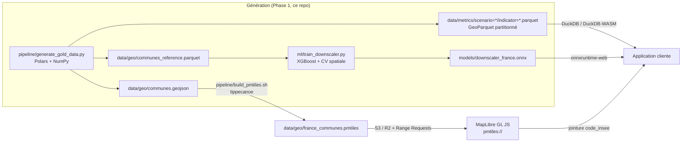

# Territoires 2100 — Phase 1

**Pipeline Big Data, GeoParquet & Machine Learning de downscaling**

Plateforme d'aide à la décision territoriale croisant projections climatiques (1950-2100) et vulnérabilités sur les ~35 000 communes de France, en paradigme **Cloud-Native Geospatial** : aucun serveur cartographique, uniquement des fichiers plats sur stockage objet (S3 / Cloudflare R2) lus par HTTP Range Requests.

> ⚠️ **Données de démonstration 100 % synthétiques**, mais géographiquement cohérentes (littoral atlantique, couloir rhodanien, massifs alpins, bassin parisien…). Elles valident l'architecture, les formats et les contrats de schéma avant l'ingestion des vraies sources (DRIAS / Euro-CORDEX, Admin Express IGN, Corine Land Cover, INSEE).

## Architecture



Deux formats complémentaires, un seul identifiant de jointure : **`code_insee`**.

| Artefact | Rôle | Contenu |
|---|---|---|
| `france_communes.pmtiles` | Géométrie pure, multi-échelle Z0-Z12 | Uniquement `code_insee` + `nom` |
| `data/metrics/scenario={ssp}/indicator={ind}.parquet` | Métriques & séries temporelles | Schéma contractuel ci-dessous |
| `communes_reference.parquet` | Dimension communale | Centroïde, département, covariables IGN-like |
| `downscaler_france.onnx` | Downscaling 8 km → 100 m | Pipeline imputer + scaler + XGBoost |

## Démarrage rapide

```bash
python3.11 -m venv .venv && .venv/bin/pip install -r requirements.txt
brew install tippecanoe            # macOS (ou voir felt/tippecanoe)

make gold      # ~35 000 communes, GeoJSON + 12 partitions Parquet (3 SSP x 4 aléas)
make pmtiles   # france_communes.pmtiles via tippecanoe
make train     # downscaler + export ONNX validé
make verify    # contrôles bout-en-bout DuckDB + ONNX + PMTiles
# ou : make all
```

## Contrat de données GeoParquet

Partitionnement Hive : `data/metrics/scenario={ssp126|ssp245|ssp585}/indicator={rga|heatwave|flooding|water_stress}.parquet` — 4 horizons pivots (1990, 2025, 2050, 2100) par fichier.

| Colonne | Type | Description |
|---|---|---|
| `code_insee` | VARCHAR (dictionnaire) | Clé de jointure avec les PMTiles |
| `year` | INT16 | Année (1950-2100 ; pivots en démo) |
| `hazard_raw` | FLOAT32 | Valeur brute type DRIAS (jours > 35 °C, indice RGA 0-10, …) |
| `hazard_local_100m` | FLOAT32 | Aléa micro-affiné par le modèle ML |
| `exposure_score` | FLOAT32 | Densité bâti, maisons individuelles, population (0-1) |
| `vulnerability_score` | FLOAT32 | Précarité énergétique, part des +65 ans (0-1) |
| `composite_risk_score` | FLOAT32 | Score composite normalisé (0-1) |

Score composite (aléa normalisé 0-1 par indicateur, percentiles 1/99) :

\[
\text{Composite} = (\text{Aléa}^{1.2} \times 0.45) + (\text{Exposition} \times 0.30) + (\text{Vulnérabilité} \times 0.25)
\]

Écriture optimisée pour DuckDB en client : compression **ZSTD**, **statistiques de colonnes activées** et dictionnaire sur `code_insee` → *predicate pushdown* et HTTP Range Requests sans téléchargement complet.

```sql
-- Top 20 des communes à risque canicule en 2050, tous scénarios, sans serveur :
-- (l'indicateur se choisit par le chemin ; `scenario` vient du partitionnement Hive)
SELECT scenario, code_insee, round(composite_risk_score, 3) AS risque
FROM read_parquet('data/metrics/*/indicator=heatwave.parquet', hive_partitioning = true)
WHERE year = 2050
ORDER BY composite_risk_score DESC LIMIT 20;
```

## Downscaling ML (8 km → 100 m)

`ml/train_downscaler.py` entraîne une régression spatiale (XGBoost, repli RandomForest) :

- **Features** : aléa régional DRIAS 8 km, altitude MNT, pente, rugosité, distance aux cours d'eau, distance au littoral, imperméabilisation, canopée.
- **Target** : température / aléa local à 100 m (gradient adiabatique −0,65 °C/100 m, îlot de chaleur urbain, brise marine, effet canopée).
- **Validation spatiale par blocs 1°×1°** (`SpatialBlockKFold`) + hold-out en damier + contrôle `GroupKFold` par département : aucune fuite par autocorrélation spatiale.
- **Export ONNX obligatoire** (`models/downscaler_france.onnx`) : imputer embarqué dans le graphe, scaler replié dans les seuils des arbres par équivalence affine (exact). Validé par comparaison `sklearn` vs `onnxruntime` sur points continus jamais vus (mean|Δ| ~1e-4, max borné par le flip d'un arbre unique en float32). Inférence possible côté client via onnxruntime-web/WASM. XGBoost est pinné `< 3.0` (format de booster non encore lu par onnxmltools).
- L'ordre des 8 features est **contractuel** (voir `models/training_report.json`).

## PMTiles

`pipeline/build_pmtiles.sh` appelle tippecanoe avec `--include=code_insee --include=nom` (contrat attributaire minimal garanti côté tuiles), `--detect-shared-borders`, simplification dynamique Z0-Z12 (`--simplification=4 --simplify-only-low-zooms`), `--drop-densest-as-needed --extend-zooms-if-still-dropping` et `--no-tiny-polygon-reduction-at-maximum-zoom` (chaque commune reste interrogeable à Z12).

Publication type : `aws s3 cp data/geo/france_communes.pmtiles s3://territoires-2100/geo/` puis lecture MapLibre via le protocole `pmtiles://`.

## Structure

```
pipeline/generate_gold_data.py   # communes synthétiques cohérentes + GeoParquet partitionné
pipeline/build_pmtiles.sh        # tippecanoe -> france_communes.pmtiles
ml/train_downscaler.py           # régression spatiale, CV par blocs, export ONNX
scripts/verify.py                # contrôles bout-en-bout (DuckDB, ONNX, PMTiles)
data/  models/                   # artefacts générés (gitignorés, régénérables via make)
```

## Limites de la Phase 1 & suite

- Centroïdes/polygones communaux synthétiques → Phase 2 : ingestion **Admin Express IGN** (vraies géométries) et tuilage identique.
- `hazard_raw` simulé par gradients physiques → Phase 2 : ingestion **DRIAS / Euro-CORDEX** en COG, agrégation zonale par commune.
- `hazard_local_100m` de démo = pseudo-downscaling paramétrique → remplacé par les prédictions du modèle ONNX entraîné sur observations (stations Météo-France + Landsat LST).
- Métropole + Corse uniquement ; extension DROM par ajout de polygones départementaux dans `DEPARTMENTS`.
